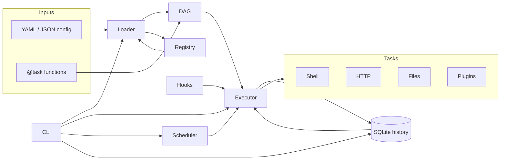

# Architecture

Autoflow is a small pipeline engine. A *pipeline* is a named DAG of *tasks*.
The *executor* walks the DAG, running ready tasks concurrently, then records
the outcome in *history* and fires *hooks*.

## Components

### Task specifications

`TaskSpec` is the unit of work: a name, a callable, dependency names, retry
policy, and timeout. The `@task` decorator attaches a `TaskSpec` to a Python
function. Config-defined tasks wrap a plugin handler in a callable with the
same shape.

### DAG

`DAG` stores tasks by name, validates that every dependency exists, and
rejects cycles (DFS) as well as self-edges and duplicates. `levels()` groups
independent tasks into concurrent waves; `ready()` is used at runtime so a
failure can skip only the downstream cone.

### Executor

The executor is fully async. A semaphore enforces `max_concurrency`. Each
task is invoked with `asyncio.wait_for` when a timeout is set. Failures
retry with exponential backoff (`backoff * factor ** attempt`, capped at
`max_backoff`). Sync callables are awaited directly when they return a
plain value, or offloaded only if they return an awaitable.

Upstream outputs are exposed to later tasks through `Context.upstream`.

### Plugins

`PluginRegistry` maps type names such as `shell` or `files.copy` to handler
classes implementing `async def run(ctx, params)`. Built-ins are registered
on first load; third-party types can advertise themselves via the
`autoflow.tasks` entry-point group.

### Config loader

`load_pipeline` reads YAML or JSON, interpolates `${VAR}` and
`${VAR:default}` from pipeline `vars`, `--var` overrides, and the
environment, then schema-validates the document and builds a `Pipeline`
that can be turned into a `DAG`.

### History

`RunHistory` stores one row per pipeline run and one row per task in
SQLite (or an in-memory database). The CLI `history` command reads from
`.autoflow/history.sqlite` by default.

### Scheduler

`CronSchedule` parses a 5-field cron expression (lists, ranges, steps,
names for months and weekdays). `Scheduler` keeps jobs in memory and fires
them when `tick()` notices that `next_run_at` has passed.

### Hooks

`HookBus` is a tiny pub/sub. Events: `run_start`, `run_complete`,
`task_start`, `task_success`, `task_failure`, `task_retry`, `task_skipped`.
Callbacks may be sync or async.

## Failure model

- A task that exhausts its retries is `failed`.
- Any task that transitively depends on a failed task is `skipped`.
- Independent branches keep running.
- The run is `success` only when every task is `success` or `skipped` and
  none are `failed`. In practice a failed task makes the run `failed`.
